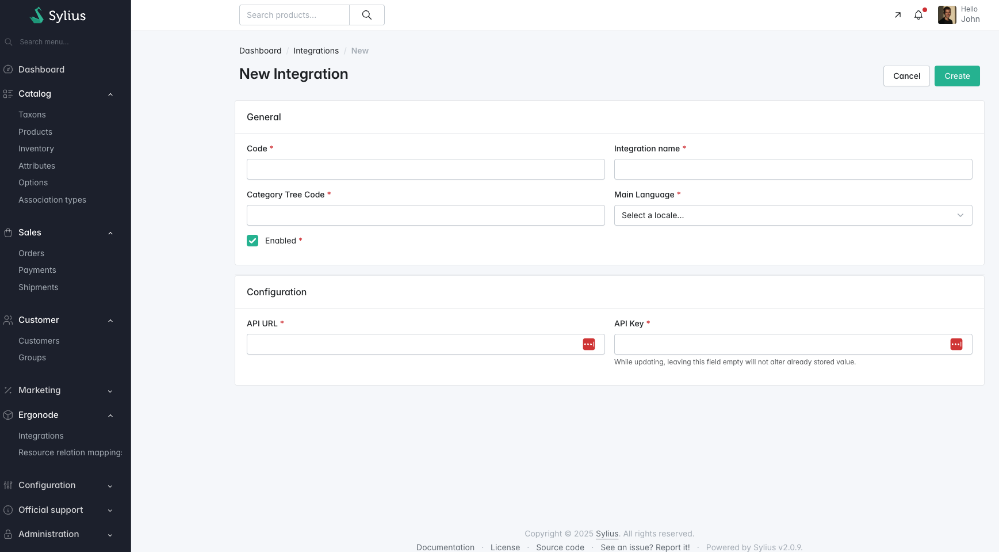

# Integration

To integrate your Sylius application with an Ergonode instance, you must configure the connection by specifying the necessary integration settings.

All fields shown above are **required** before synchronization can be initialized.

---

## Configuration Properties

The following table explains each required property:

| Property             | Description                                                                                                                                                       |
|----------------------|-------------------------------------------------------------------------------------------------------------------------------------------------------------------|
| `Category Tree Code` | The code of the category tree to be synchronized into Sylius.   Only categories that belong to this tree will be considered during synchronization.           |
| `Main Language`      | The primary language used for the integration.   If certain property does not support translation, corresponding value of main language will be used instead. |
| `API URL`            | The base URL of your Ergonode instance, e.g. `https://my_ergonode_instance`   It <b>cannot </b> have any endpoint specified.                                  |
| `API Key`            | The authentication key used to access the Ergonode API.   It must be generated beforehand in the Ergonode panel.                                              |

> ⚠️ **Important:** Ensure the API Key is scoped to the correct product segment in Ergonode. Incorrect scoping may result in missing or partial data during synchronization.

---

