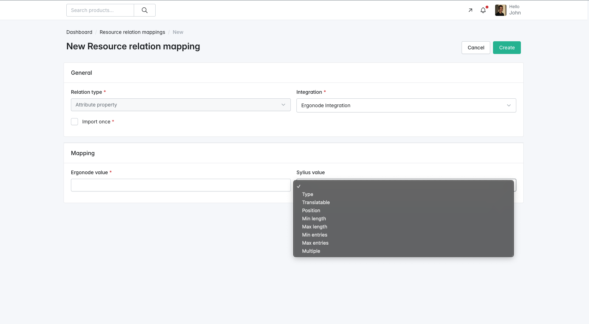
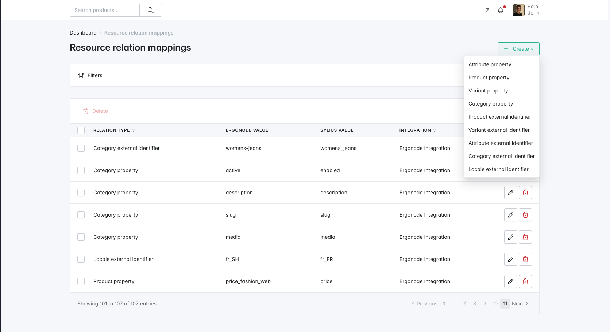

# Resource Relation Mapping

## Concept

To ensure accurate synchronization between Sylius and Ergonode resources, the plugin provides a **Resource Relation Mapping** mechanism.
Alternative approach requires that Ergonode attribute codes will align exactly with Sylius properties, which is not always possible and might cause some inconsistent effects. 

This feature allows you to:

- Explicitly map existing Sylius resources to their counterparts in Ergonode.
- Define which Ergonode attribute or metadatum should populate a specific property of a Sylius resource (e.g., product name, description, variant price).

This is especially crucial for complex resources such as products, where various attributes must be correctly aligned between systems.

---

## Creating a Resource Relation Mapping

When creating a relation mapping:

- All available Sylius resources are embedded as selectable options for convenience.
- You can specify whether a property's value should:
    - Be **imported only once** (static value on creation, first sync and full sync)
    - Be **continuously synchronized** (updated with every sync).

This is particularly useful for handling dynamic data like prices and stock levels, while keeping static data like SKUs stable.

---

## Available Relation Types

The following types of resource relations can be defined.

---

## Role of Subtypes

These relation types fall into two main groups:

### 1. External Identifiers

These map the **identity relationship** between Ergonode and Sylius resources. For example:

- `Product external identifier` maps an Ergonode product `sku_123` to a Sylius product `slim_fit_jeans`.
- `Locale external identifier` aligns Ergonode locale `pl_SY` with locale `pl_PL` in Sylius.

### 2. Properties

These define **which Ergonode attribute value or metadata** should be written into which Sylius resource property. For example:

- `Attribute property` may define that Ergonode attribute with code `label` maps to property `name` of Sylius product.
- `Variant property` might map the Ergonode attribute with code `price` to the `original price` of variant.

---

Proper configuration of these mappings is essential for a reliable and meaningful Ergonode → Sylius data flow.
