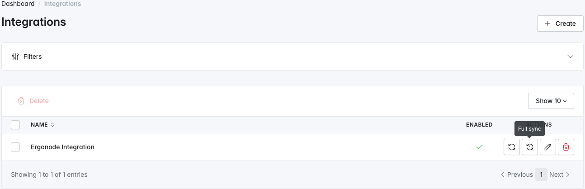
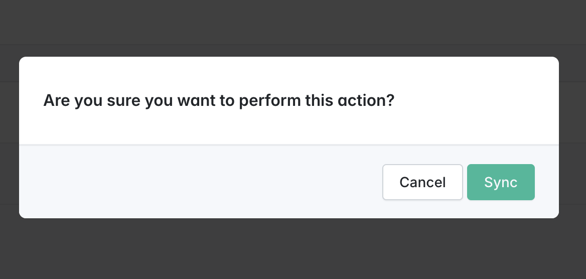

# Synchronization
## Modes
Plugin offers two synchronization modes: `Sync` and `Full sync`. 
As one can correctly infer from modes names, `Sync` imports only data altered since last synchronization, while `Full sync` synchronizes data completely, importing every resource and property, also modifying values meant to be imported only once.

>First synchronization, independently of the selected mode, is always a `Full sync`
>  
## Entrypoints

To trigger process of data synchronization from Ergonode to Sylius you can use one of available entrypoints: </br>
- CLI command.
- Action placed on the integrations list in admin panel section

## CLI command
From within your project, you can trigger the default synchronization using this command. </br>
Replace `<integration-code>` with code of integration you'd prefer to use for synchronization.

```shell
  bin/console bitbag-sylius-ergonode:synchronize <integration-code>
```
If you'd like to run full synchronization, you need to add `-f` or `--full` flag to the command
```shell
  bin/console bitbag-sylius-ergonode:synchronize <integration-code> -f
```

## Admin panel button

From the admin panel, after entering `Integrations` section, you can see synchronization buttons in the `Actions` column.



After clicking each of them, you'll be asked to confirm performing the action.



## What happens afterwards

After you either trigger the synchronization manually or via CLI, a message is sent via Symfony Messenger to your preferred queue. 
The message will contain the synchronization mode and integration code.

After the synchronization is started, resources are being pulled through *Ergonode GraphQL API*. They follow the order :
- categories 
- attributes
- products 

After pulling each batch of resources, currently synchronized and processed group is being saved in the database. It also sets the last cursor of resource stream to the end cursor of current page. 
